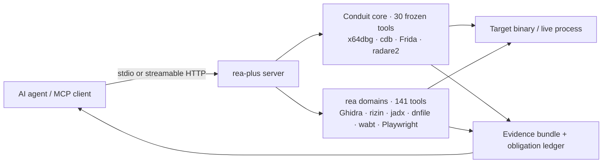

<div align="center">


# Reverse Engine Anything Plus

**One MCP server for reverse engineering — live Windows debugging plus a 141-tool static-analysis suite for PE/ELF, .NET, APK, WASM/EVM, firmware, and the web.**

Your agent asks questions; rea-plus inspects the binary and answers with evidence, not guesses.

[](https://github.com/Alyhnte/ReaPlus/actions/workflows/ci.yml)
[](https://github.com/Alyhnte/ReaPlus/releases)
[](#-features)
[](#-tests)
[](https://nodejs.org)
[](LICENSE)

[Install](#-install) · [Clients](#-client-setup) · [Docker](#-docker) · [Features](#-features) · [How it works](#-how-it-works) · [Security](#-security-model) · [Roadmap](docs/ROADMAP.md) · [FAQ](#-faq)

</div>

---

## ✨ Why rea-plus?

- 🐞 **Real debugging, not screenshots** — x64dbg, cdb (WinDbg), and Frida engines behind one frozen 30-tool core: breakpoints, stepping, registers, memory, call stacks, time-travel checkpoints.
- 🧰 **141 static tools** — Ghidra headless, rizin/radare2, .NET CIL (dnfile) and ILSpy, jadx/apktool/adb, WASM + EVM, firmware, browser/HAR, UPX, PE/ELF/Mach-O readers, and more.
- 🤝 **Honest by design** — a missing backend answers `capability_unsupported` with an install hint. Nothing fakes a result, errors come back as proper MCP `isError`, and mutating live-debug calls require `confirm:true`.
- 🔌 **Two transports** — stdio for local agents, streamable HTTP (`/mcp` + `/health`, bearer token, localhost Host/Origin validation) for shared setups.
- 🧪 **Proven, not promised** — 371 tests, a default lane that is green on Windows and Ubuntu CI, and an e2e that spawns the real server.

```console
$ rea-plus-cli doctor            # what is installed on this machine, what is missing
$ rea-plus-cli analyze-evm "transfer(address,uint256)"
transfer(address,uint256) -> 0xa9059cbb
```

```jsonc
// One MCP call your agent makes:
{ "name": "rea_investigate", "arguments": { "path": "sample.exe" } }
// -> sniff + confidence + provider plan + evidence bundle, in one answer
```

## 🚀 Install

> **Requirements:** Node.js ≥ 20. Everything else (Ghidra, rizin, jadx, Frida tooling, …) is optional — tools light up as backends appear; run `doctor` to see your machine's map. Windows is required for the live debuggers (x64dbg/cdb/Frida attach); static analysis runs anywhere.

### One-click (Cursor / VS Code)

[](https://cursor.com/install-mcp?name=rea-plus&config=eyJjb21tYW5kIjoibnB4IiwiYXJncyI6WyIteSIsImdpdGh1YjpBbHlobnRlL1JlYVBsdXMiXX0=)
[](https://vscode.dev/redirect/mcp/install?name=rea-plus&config=%7B%22type%22%3A%22stdio%22%2C%22command%22%3A%22npx%22%2C%22args%22%3A%5B%22-y%22%2C%22github%3AAlyhnte%2FReaPlus%22%5D%7D)

### npx (no clone)

Any stdio MCP client can launch it straight from GitHub — the first run builds in a few seconds:

```json
{
  "mcpServers": {
    "rea-plus": {
      "command": "npx",
      "args": ["-y", "github:Alyhnte/ReaPlus"]
    }
  }
}
```

### Clone & build

```bash
git clone https://github.com/Alyhnte/ReaPlus.git
cd ReaPlus
npm ci
npm run build        # tsc + runtime assets (frida-agent.js, Ghidra scripts) -> dist/
npm start            # stdio server (dist/server.js)

# Optional HTTP transport:
node dist/server.js --transport http --port 3848
# -> GET  http://127.0.0.1:3848/health
# -> POST http://127.0.0.1:3848/mcp
```

### Optional extras

```bash
# Browser tools (Playwright is an optional dependency, loaded lazily):
npm i playwright && npx playwright install chromium
```

Then point your agent at it and ask it to inspect something.

## 🔌 Client setup

Every client below gets the same server. Ready-made files live in [`configs/`](configs/).

<details>
<summary><strong>Claude Desktop</strong></summary>

Add to `claude_desktop_config.json` (see [`configs/claude-desktop/`](configs/claude-desktop/claude_desktop_config.stdio.json)):

```json
{
  "mcpServers": {
    "rea-plus": { "command": "npx", "args": ["-y", "github:Alyhnte/ReaPlus"] }
  }
}
```

</details>

<details>
<summary><strong>Claude Code</strong></summary>

```bash
claude mcp add rea-plus -- npx -y github:Alyhnte/ReaPlus
```

Or drop [`configs/claude-code/.mcp.json`](configs/claude-code/.mcp.json) into your project root.

</details>

<details>
<summary><strong>Cursor</strong></summary>

Click **Add to Cursor** above, or use [`configs/cursor/mcp.stdio.json`](configs/cursor/mcp.stdio.json) (clone path form) / [`mcp.http.json`](configs/cursor/mcp.http.json) (HTTP form).

</details>

<details>
<summary><strong>VS Code</strong></summary>

Click **Install in VS Code** above, or copy [`configs/vscode/mcp.json`](configs/vscode/mcp.json) to `.vscode/mcp.json` in your workspace.

</details>

<details>
<summary><strong>Windsurf</strong></summary>

Use [`configs/windsurf/mcp_config.json`](configs/windsurf/mcp_config.json) as your `mcp_config.json`.

</details>

<details>
<summary><strong>Codex</strong></summary>

Append [`configs/codex/config.toml`](configs/codex/config.toml) to `~/.codex/config.toml`:

```toml
[mcp_servers.rea-plus]
command = "npx"
args = ["-y", "github:Alyhnte/ReaPlus"]
```

</details>

<details>
<summary><strong>opencode / generic HTTP</strong></summary>

```bash
DBG_BRIDGE_TOKEN=your-secret node dist/server.js --transport http --port 3848
# clients connect to http://127.0.0.1:3848/mcp with Authorization: Bearer <token>
```

See [`configs/opencode/`](configs/opencode/opencode.stdio.json) for stdio and HTTP variants.

</details>

## 🐳 Docker

```bash
# Build locally (works today):
docker build -t rea-plus .

# stdio (for MCP clients that spawn containers):
docker run -i --rm rea-plus

# HTTP:
docker run -p 3848:3848 -e DBG_BRIDGE_TOKEN=your-secret rea-plus --transport http --port 3848 --host 0.0.0.0
```

Images are published to GHCR on each release (`ghcr.io/alyhnte/reaplus`). Windows-only
debuggers (x64dbg/cdb) report `capability_unsupported` inside a Linux container; static
analysis, the CLI, and both transports work.

## 🧰 Features

| Domain | What you get | Engine / backend |
|---|---|---|
| Live debugging | Breakpoints, step/continue, registers, memory, call stacks, checkpoints & rewind | x64dbg · cdb · Frida · radare2 (conduit core, 30 frozen tools) |
| Native static (PE/ELF) | Disassembly, CFG, xrefs, strings, imports, PDB/DWARF, decompile | Ghidra headless · rizin/Cutter |
| .NET | Real CLR detection, CIL dump via dnfile, ILSpy decompile | dnfile · ilspycmd |
| Android | APK decode/build, framework info, adb bridge | jadx · apktool · aapt2 · adb |
| Dynamic instrumentation | Attach/spawn, API tracing, conditional breakpoints, process pause | Frida 17 |
| Behavior | Process runs with SHA-256 records, network capture (HAR), event timelines | mitmproxy · process capture |
| Web / browsers | Navigation, clicks, screenshots, storage & console capture | Playwright (optional extra) |
| WASM / EVM | Validation (wabt), disassembly, function selectors, opcode work | wabt · offline keccak |
| Firmware & exotic | Firmware triage, DOS/MIPS/AOT/Go pre-scans, packer hunt (UPX→.NET→dump recipe) | Static inspection · UPX |
| Investigation | One-call triage: sniff → confidence → provider plan → evidence bundle | `rea_investigate` orchestrator |
| Assistance | Capability probing + caching, fallback chains, config suggestions, telemetry | Built-in, offline |

## ⚙️ How it works



- **Frozen core.** The 30 conduit tool names are immutable (`src/facade/toolNamespace.ts`); renames are forbidden, so existing conduit clients keep working.
- **rea domains.** 141 `rea_*` tools register centrally in `src/server/registerReaTools.ts`.
- **Confirm gates.** Live operations that mutate a target require `confirm:true`; otherwise you get `confirmation_required`, never a silent side effect.
- **One catalog.** `mergedCatalog()` (8 conduit + 16 rea prerequisite entries) is the single source `doctor` reads for versions and download links.

## 💻 CLI

The same engines are scriptable from the terminal (`rea-plus-cli`, or `node dist/cli/index.js` in a clone):

```bash
rea-plus-cli analyze-evm "transfer(address,uint256)"     # -> 0xa9059cbb (fully offline)
rea-plus-cli analyze-evm "approve(address,uint256)" --json
rea-plus-cli analyze-wasm sample.wat --json
rea-plus-cli analyze-js bundle.js bundle.js.map
rea-plus-cli doctor --json                                # per-tool readiness report
```

## 🔧 Configuration

All configuration is environment variables — no config files to edit in the server itself.

| Variable | Purpose |
|---|---|
| `DBG_BRIDGE_TOKEN` | Bearer token for the HTTP transport (unset = auth off + startup warning) |
| `DBG_BRIDGE_FRIDA_TIMEOUT_MS` | Frida agent RPC timeout (default 30000) |
| `REA_GHIDRA_DIR` | Ghidra installation directory for provider-backed analysis |
| `REA_UPX_BIN` · `REA_WABT_BIN` · `REA_AAPT2_BIN` | Explicit tool paths when not on PATH |
| `REA_JEB_MCP_URL` · `REA_JEB_ALLOW_REMOTE` | JEB endpoint; remote (non-loopback) requires `REA_JEB_ALLOW_REMOTE=1` |
| `REA_CDP_URL` | Attach browser tools to an existing Chrome DevTools endpoint |
| `REA_CORELIB_DLL` | Preferred .NET runtime DLL for CIL inspection |

External tools are discovered from these variables and PATH only — no machine-specific paths are baked in.

## 🔒 Security model

rea-plus is a debugger: by design it can launch, attach to, and instrument local processes. Treat access to it like shell access.

- **stdio first.** The default transport never opens a port.
- **HTTP is locked down.** Bearer token (constant-time compare), localhost Host/Origin validation against DNS-rebinding/CSRF, and a loud warning when started without a token.
- **Inputs are validated.** Addresses that reach backend command languages are restricted to hex/decimal/symbol form — no `;`/`!` command injection into r2/rizin.
- **SSRF gate.** Outbound helper calls (e.g. the JEB bridge) are loopback-only unless the operator opts in; link-local/metadata hosts are always blocked.
- **No fake results.** Missing capability ⇒ `capability_unsupported` with a reason; handler errors ⇒ MCP `isError` with the message only (no stack traces).
- **No target execution in static paths.** Inspection tools read bytes; they never run the sample. Run unknown binaries in a VM — that is what the live lane is for.

## 🧪 Tests

50 files, 371 its. The default lane (`npm test`) runs 43 files / 321 its and excludes the live-injection/debugger, packet-capture, browser, e2e, and local-Ghidra suites — those touch real processes or machine-specific installs and belong to a VM or a dedicated CI job (`npm run test:live`). Every file is capped at 90s with process-tree kill, so a hung backend can never hang the lane. CI runs the default lane on Ubuntu (Node 20 + 22) and it is green there and on Windows.

```bash
npm test                        # default lane: 43 files (live suites excluded)
npm run test:live               # everything, incl. frida/sniff/browser/e2e/ghidra (VM/CI only)
npm run test:e2e                # spawn -> /health -> tools/list
node --test tests/evm.test.mjs # single-domain runs work too
```

Details: [`docs/VERIFY.md`](docs/VERIFY.md) · [`docs/MCP-CONTRACTS.md`](docs/MCP-CONTRACTS.md) · [`CHANGELOG.md`](CHANGELOG.md)

## 🗺️ Roadmap

Near the top of the list — the full, prioritized table lives in [`docs/ROADMAP.md`](docs/ROADMAP.md):

- npm publish + MCP Registry listing (one-command `npx rea-plus`)
- MCP resources/prompts, `outputSchema`/`structuredContent`, progress + cancellation for long analyses
- Toolset profiles so small-context clients can load a slice of the 171 tools
- Syscall/file/registry behavior profiles, repo-scale scanning with a persistent worker
- A golden binary corpus with expected-output hashes per provider

## ❓ FAQ

**Do I need Ghidra, IDA, Hopper, or JEB?**
No. Static JS/.NET/WASM/EVM and offline inspection work without them; provider-backed depth uses your own installations when present. Commercial tools are never bundled or licensed by rea-plus.

**Why does a tool return `capability_unsupported`?**
Its backend is not installed on this machine. The response names the missing capability and where to get it (the same catalog `doctor` reads). Install it and the tool lights up — no code changes.

**Why do live operations need `confirm:true`?**
They mutate a running target (breakpoints, stepping, memory writes). The gate keeps agents from changing program state by accident.

**Does it clash with conduit?**
No. Conduit defaults to port 3847; rea-plus serves 3848, and the 30 conduit tool names are frozen.

**npm says the package is not found?**
`rea-plus` is not on the npm registry yet (registry publish is on the roadmap). Use the GitHub form everywhere above: `npx -y github:Alyhnte/ReaPlus`.

## 🤝 Contributing

Issues and PRs are welcome — bug reports, feature ideas, docs. Run `npm run typecheck` and `npm test` before submitting, keep conduit tool names frozen, and make new tools fail honestly (`capability_unsupported`, never a fake `ok`).

If rea-plus saved you an afternoon of hex-editor archaeology, a ⭐ helps other reversers find it.

## 📄 License

[MIT](LICENSE). rea-plus code is MIT licensed; third-party tools and providers keep their own licenses — you must legally obtain and be authorized to use commercial tools (IDA Pro, Hopper, JEB) under their vendor terms.

<div align="center">

**Reverse Engine Anything Plus** · built on the conduit live-debug core · [Releases](https://github.com/Alyhnte/ReaPlus/releases) · [Roadmap](docs/ROADMAP.md) · [Changelog](CHANGELOG.md)

</div>


